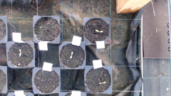
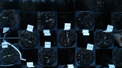
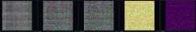
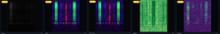

# Data notes: known issues and quality labels

Things to watch out for when working with the ADA 2025 camera data. The
file formats themselves are described in [data_files.md](data_files.md).

Placeholders marked **TODO (team)** still need an example image or a
confirmation from the people who ran the acquisition.

## Missing data

About 6.44 % of the planned camera data (Aug 12 to Sep 22, five scheduled
runs per day at 06, 09, 12, 15 and 18 h, all 216 plants) could not be
collected because of robot or camera problems (8.5 % without the re-runs
described below). `utils/camera_data_summary.py` computes these figures.

**Re-runs.** When a scheduled run failed, the robot was often re-run shortly
afterwards, so the dataset also contains off-schedule runs (e.g. 07, 13 or
16 h). All of them are included in the published data. A re-run within
±1 h of a scheduled slot counts as recovering that slot. The thermal scripts
in this repository use the same rule; in the exemplary analyses this applies
once (W2 thermal on 2025-09-11, taken from the 16:00 re-run).

**Scheduled slots without data** (after re-runs are taken into account;
unless noted otherwise, all 72 plants of each listed bed are affected):

| Date | Slot (h) | RGB | Depth | Thermal | HSI |
|---|---|---|---|---|---|
| 2025-08-15 | 09, 12 | W1-W3 | | | |
| 2025-08-26 | 18 | | | | W3 |
| 2025-08-29 | 18 | | | W3 (24 plants) | |
| 2025-09-02 | 09 | | | | W3 |
| 2025-09-05 | 06 | W1-W3 | W1-W3 | W1-W3 | W1-W3 |
| 2025-09-06 | 06 | W2, W3 | W2, W3 | W1-W3 | W1-W3 |
| 2025-09-07 | 06 | | | W1-W3 | |
| 2025-09-07 | 12 | W2, W3 | W2, W3 | W2, W3 | W1-W3 |
| 2025-09-07 | 18 | | | | W1 |
| 2025-09-08 | 09 | W2, W3 | W2, W3 | W2, W3 | W1-W3 |
| 2025-09-10 | 06 | | | W2, W3 | |
| 2025-09-15 | 15 | | | W2 (69 plants) | |
| 2025-09-18 | 06 | | | W1-W3 | |
| 2025-09-19 | 15, 18 | | W1-W3 | | |
| 2025-09-20 | 06-15 | | W1-W3 | | |
| 2025-09-20 | 18 | | W1-W3 | W3 | |
| 2025-09-21 | 06, 18 | | W1-W3 | W3 | |
| 2025-09-21 | 09 | | W1-W3 | | |
| 2025-09-21 | 12 | | W1-W3 | W2, W3 | |
| 2025-09-21 | 15 | | W1-W3 | | |
| 2025-09-22 | 06 | | W1-W3 | W2, W3 | |
| 2025-09-22 | 09 | | W1-W3 | | |
| 2025-09-22 | 12, 15, 18 | W1-W3 | W1-W3 | W1-W3 | W1-W3 |

Notes:

- Depth is missing for every run from 2025-09-19 15 h to the end of
  collection.
- 2025-09-22 is the last day of collection; there is no data for its 12, 15
  and 18 h slots.
- Apart from the slots above, a slot either has the full number of frames or
  none; partially recorded runs are rare (one plant-slot in the whole period).

## Image quality

- **Dark images (RGB, HSI).** Images from the early and late runs (06 and
  18 h, and re-runs close to them) are often dark, depending on the date and
  the weather.
- **HSI overexposure.** The hyperspectral exposure is set automatically once
  per run, when the sensor starts. If the lighting changes after that, images
  later in the run can be overexposed.

## Robot position data

- Each RGB, depth and thermal folder has a `frames_<sensor>.csv` with the
  robot position per frame (see [data_files.md](data_files.md)). The position
  is off in places, which shows up as an offset between modalities when the
  depth, RGB and thermal data are fused into a point cloud
  (`analysis/combined/3d_viewer.py`).
- On 2025-08-29 and 2025-09-15, some RGB and depth folders have no
  `frames_*.csv`.
- **TODO (team):** add the known position problems (dates/beds) here.

## Quality labels

**TODO (team):** fill in the labels used for the published data, with a short
meaning and, where available, how often each occurs per modality.

### Automatically generated labels

| Label | Modality | Meaning |
|---|---|---|
| *TODO* | | |

### Manual labels

A subset of the dataset was manually reviewed for image-quality and
acquisition issues: eight plants, four in `W1` (`W1_B5`, `W1_E4`, `W1_G6`,
`W1_K6`) and four in `W2` (`W2_B3`, `W2_G2`, `W2_I6`, `W2_Q6`); no `W3`
plant was reviewed. The review covers 1,860 plant/date/hour records from
2025-08-11 to 2025-09-22 and was carried out by the authors. Flags describe
individual frames or derived images (HSI index images, 3D views). `Missing`
is the exception: it marks a modality that is entirely absent for that run.
The labels are in
[`manually_checked_data.json`](../analysis/dataset_issues/manually_checked_data.json);
the schema and label counts are in
[`manually_checked_data_description.md`](../analysis/dataset_issues/manually_checked_data_description.md).

| Label | Modality | Meaning |
|---|---|---|
| `Missing` | RGB, Depth, Thermal, HSI, 3D | A modality is missing |
| `Medium Dark` | RGB, HSI, 3D | Moderately dark image/view |
| `Dark` | RGB, HSI, 3D | Image/view is dark|
| `Medium Bright` | RGB, HSI | Moderately bright image/view |
| `Bright` | RGB | Image is bright |
| `Medium Blurred` | RGB, Thermal, HSI, 3D | Moderately blurred image/view |
| `Blurred` | RGB, Thermal, HSI | Blurred image/view |
| `Not Centered` | RGB, Depth, Thermal, 3D | Plant is not centered in frame/view|
| `Artifact` | RGB, Depth, Thermal, HSI, 3D | Image/view contains an artifact |
| `Medium Artifact` | RGB, Depth, HSI, 3D | Image/view contains a moderate artifact|
| `water hose` | Depth | Water hose visible in the acquisition |
| `Offset` | 3D | 3D view is offset/misaligned |
| `no plant` | Thermal | No plant visible in the image |

## Example quality labels

| Issue | Modality | Image |
|---|---|---|
| Dark (early/late run) | RGB |  |
| Bright | RGB |  |
| Artifact (image tear) | RGB |  |
| Dark (early/late run) | HSI |  |
| Artifact | HSI |  |

