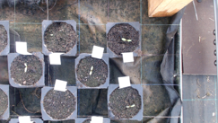
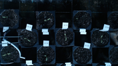
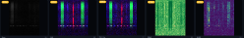

# Data notes: known issues and quality labels

Things to watch out for when working with the ADA 2025 camera data. The
file formats themselves are described in [data_files.md](data_files.md).

Placeholders marked **TODO (team)** still need an example image or a
confirmation from the people who ran the acquisition.

## Missing data

About 6.44 % of the planned camera data (Aug 12 to Sep 22, five scheduled
runs per day at 06, 09, 12, 15 and 18 h, all 216 plants) could not be
collected because of robot or camera problems (8.5 % without the re-runs
described below). `utils/camera_data_summary.py` computes these figures.

**Re-runs.** When a scheduled run failed, the robot was often re-run shortly
afterwards, so the dataset also contains off-schedule runs (e.g. 07, 13 or
16 h). All of them are included in the published data. A re-run within
±1 h of a scheduled slot counts as recovering that slot. The thermal scripts
in this repository use the same rule; in the exemplary analyses this applies
once (W2 thermal on 2025-09-11, taken from the 16:00 re-run).

**Scheduled slots without data** (after re-runs are taken into account;
unless noted otherwise, all 72 plants of each listed bed are affected):

| Date | Slot (h) | RGB | Depth | Thermal | HSI |
|---|---|---|---|---|---|
| 2025-08-15 | 09, 12 | W1-W3 | | | |
| 2025-08-26 | 18 | | | | W3 |
| 2025-08-29 | 18 | | | W3 (24 plants) | |
| 2025-09-02 | 09 | | | | W3 |
| 2025-09-05 | 06 | W1-W3 | W1-W3 | W1-W3 | W1-W3 |
| 2025-09-06 | 06 | W2, W3 | W2, W3 | W1-W3 | W1-W3 |
| 2025-09-07 | 06 | | | W1-W3 | |
| 2025-09-07 | 12 | W2, W3 | W2, W3 | W2, W3 | W1-W3 |
| 2025-09-07 | 18 | | | | W1 |
| 2025-09-08 | 09 | W2, W3 | W2, W3 | W2, W3 | W1-W3 |
| 2025-09-10 | 06 | | | W2, W3 | |
| 2025-09-15 | 15 | | | W2 (69 plants) | |
| 2025-09-18 | 06 | | | W1-W3 | |
| 2025-09-19 | 15, 18 | | W1-W3 | | |
| 2025-09-20 | 06-15 | | W1-W3 | | |
| 2025-09-20 | 18 | | W1-W3 | W3 | |
| 2025-09-21 | 06, 18 | | W1-W3 | W3 | |
| 2025-09-21 | 09 | | W1-W3 | | |
| 2025-09-21 | 12 | | W1-W3 | W2, W3 | |
| 2025-09-21 | 15 | | W1-W3 | | |
| 2025-09-22 | 06 | | W1-W3 | W2, W3 | |
| 2025-09-22 | 09 | | W1-W3 | | |
| 2025-09-22 | 12, 15, 18 | W1-W3 | W1-W3 | W1-W3 | W1-W3 |

Notes:

- Depth is missing for every run from 2025-09-19 15 h to the end of
  collection.
- 2025-09-22 is the last day of collection; there is no data for its 12, 15
  and 18 h slots.
- Apart from the slots above, a slot either has the full number of frames or
  none; partially recorded runs are rare (one plant-slot in the whole period).

**Hyperspectral scans outside the collection period.** The hyperspectral
archives also hold 17 runs (all 216 plants, 3,672 images) dated outside
Aug 12 to Sep 22: 2025-08-11 at 17 and 18 h, daily 06 h runs from 2025-09-25
to 2025-10-09 (none on 10-05), 2025-09-26 at 11 h, and 2025-11-07 at 10 h.
They contain no plant data (spot checks: empty pots before emergence on
08-11, dark noise on the October 06 h runs, a calibration chessboard on
11-07; the plants were composted on 09-22). Exclude them; the paper's
hyperspectral total (50,544) does not count them. `utils/check_robot_positions.py`
lists them.

## Image quality

- **Dark images (RGB, HSI).** Images from the early and late runs (06 and
  18 h, and re-runs close to them) are often dark, depending on the date and
  the weather.
- **HSI overexposure.** The hyperspectral exposure is set automatically once
  per run, when the sensor starts. If the lighting changes after that, images
  later in the run can be overexposed.

## Robot position data

Each RGB, depth and thermal folder has a `frames_<sensor>.csv` with the robot
position per frame (see [data_files.md](data_files.md)). Per plant and run the
robot visits a fixed grid (RGB and depth: 3 x 5 frames, thermal: 1 x 5), so
frame `007` (RGB, depth) or `002` (thermal) is normally centered on the plant.
`utils/check_robot_positions.py` checks every frame against the logs and the
archive checksums and writes the flagged runs to
[`robot_position_flags.csv`](../analysis/dataset_issues/robot_position_flags.csv)
(columns: run, `no_csv`, the frames flagged `off_position` and `stalled`,
whether the center frame is off, the largest offset, and the largest number
of plants sharing one image). Counts below are for the full V2 dataset.

**The logged positions are reliable.** On the eight manually reviewed plants
(see [Manual labels](#manual-labels)), a frame logged more than 5 cm from the
plant's usual position for that frame number was labelled `Not Centered` by
the reviewers in 99-100 % of cases, and 99-100 % of `Not Centered` frames have
such an offset (RGB 1,643 of 1,661, depth 190 of 190, thermal 162 of 162).
So use the logged position, not the frame number, to decide where a frame was
taken.

**Frames taken off position.** A frame is flagged `off_position` when it was
logged more than 5 cm from the plant's median position for that frame number:

| Modality | Frames off position | Runs affected | Runs with the center frame off |
|---|---:|---:|---:|
| RGB | 40,506 of 761,400 (5.3 %) | 19,013 of 50,760 | 2,835 |
| Depth | 5,696 of 694,440 (0.8 %) | 436 of 46,296 | 382 |
| Thermal | 4,915 of 231,373 (2.1 %) | 1,001 of 46,275 | 986 |

RGB frames are most often affected: the RGB capture sometimes slips to the
next grid position (typically 10 cm), so the frame numbered `007` can show the
neighboring position (e.g. `W2_J5` on 2025-09-06 and 2025-09-09 at 15 h; the
16 h re-runs are centered). Depth and thermal offsets mostly come from the
stalls below. To get a centered image, take the frame whose logged position is
closest to the plant's usual center position, or a re-run within ±1 h.

**Stalled runs (duplicated images).** In some runs the robot stopped moving
part-way through a bed and the same capture was saved for every remaining
plant: the files are byte-identical across plants, and the logged position is
the same for all of them. Neighboring plants normally share a few RGB and
depth frames (up to about 4 plants for RGB and 8 for depth, from overlapping
grids); thermal frames are never shared. A frame is flagged `stalled` when its
image is identical for at least 5 (RGB), 9 (depth) or 2 (thermal) plants.
Flagged: RGB 4,097 frames (455 runs), depth 4,858 (413), thermal 4,878 (994).
The image totals in the paper include these duplicates. Runs where one image
was saved for 10 or more plants of a bed:

| Date | Hour | Bed | RGB | Depth | Thermal |
|---|---|---|---:|---:|---:|
| 2025-08-14 | 16 | W2 | 57 | 67 | 23 |
| 2025-08-24 | 07 | W2 | | | 28 |
| 2025-08-26 | 13 | W1 | 34 | 51 | 33 |
| 2025-08-26 | 18 | W3 | 43 | 48 | 10 |
| 2025-08-28 | 15 | W3 | 10 | | |
| 2025-09-02 | 18 | W2 | | | 57 |
| 2025-09-06 | 06 | W1 | 72 | 72 | |
| 2025-09-06 | 15 | W3 | | 34 | 17 |
| 2025-09-07 | 12 | W1 | 27 | 48 | 53 |
| 2025-09-08 | 09 | W1 | 43 | 51 | 36 |
| 2025-09-09 | 15 | W3 | | | 40 |
| 2025-09-10 | 06 | W1 | | | 69 |
| 2025-09-10 | 18 | W3 | | | 63 |
| 2025-09-12 | 06 | W2 | | | 32 |
| 2025-09-16 | 09 | W2 | | | 60 |
| 2025-09-16 | 15 | W3 | | | 36 |
| 2025-09-19 | 12 | W1 | | 20 | |
| 2025-09-19 | 18 | W3 | | | 45 |
| 2025-09-20 | 19 | W2 | | | 56 |
| 2025-09-21 | 09 | W1 | | | 28 |
| 2025-09-21 | 15 | W2 | | | 48 |
| 2025-09-21 | 19 | W2 | | | 53 |
| 2025-09-22 | 06 | W1 | | | 25 |

(Numbers are plants; the plants of a bed after the stall point are affected,
so which plants depends on the run.)

**Missing position files.** Some runs have images but no
`frames_<sensor>.csv`: 2025-08-29 18 h `W3` (RGB and depth: 72 plants,
thermal: 48) and 2025-09-15 15 h `W2` (RGB and depth: 72 plants, thermal: 3).

**Exemplary analyses.** In the paper's subset (`W1`/`W2`, plants A2, A8, J5,
R1, R7, 15 h runs, Sep 3-14) no depth or thermal frame is flagged. Six RGB
runs have the center frame `007` off position (`W1_J5` 09-04 and 09-13,
`W1_R7` 09-08, `W2_J5` 09-06, 09-09 and 09-10); the plant-height pipeline
applies each RGB frame's logged position when it colors the depth points
(`analysis/plant_height/step_01_build_pointclouds.py`), which compensates for
the offset.

## Quality labels

**TODO (team):** fill in the labels used for the published data, with a short
meaning and, where available, how often each occurs per modality.

### Automatically generated labels

Computed for the whole dataset by `utils/check_robot_positions.py` (see
[Robot position data](#robot-position-data)), one row per flagged run in
[`robot_position_flags.csv`](../analysis/dataset_issues/robot_position_flags.csv):

| Label | Modality | Meaning |
|---|---|---|
| `off_position` | RGB, Depth, Thermal | Frame logged > 5 cm from the plant's usual position for that frame number; matches the manual `Not Centered` label |
| `stalled` | RGB, Depth, Thermal | Image byte-identical for more plants than normal frame sharing explains (robot stopped; duplicated capture) |
| `no_csv` | RGB, Depth, Thermal | Run has images but no `frames_<sensor>.csv` |

### Manual labels

A subset of the dataset was manually reviewed for image-quality and
acquisition issues: eight plants, four in `W1` (`W1_B5`, `W1_E4`, `W1_G6`,
`W1_K6`) and four in `W2` (`W2_B3`, `W2_G2`, `W2_I6`, `W2_Q6`); no `W3`
plant was reviewed. The review covers 1,860 plant/date/hour records from
2025-08-11 to 2025-09-22 and was carried out by the authors. Flags describe
individual frames or derived images (HSI index images, 3D views). `Missing`
is the exception: it marks a modality that is entirely absent for that run.
The labels are in
[`manually_checked_data.json`](../analysis/dataset_issues/manually_checked_data.json);
the schema and label counts are in
[`manually_checked_data_description.md`](../analysis/dataset_issues/manually_checked_data_description.md).

| Label | Modality | Meaning |
|---|---|---|
| `Missing` | RGB, Depth, Thermal, HSI, 3D | A modality is missing |
| `Medium Dark` | RGB, HSI, 3D | Moderately dark image/view |
| `Dark` | RGB, HSI, 3D | Image/view is dark|
| `Medium Bright` | RGB, HSI | Moderately bright image/view |
| `Bright` | RGB | Image is bright |
| `Medium Blurred` | RGB, Thermal, HSI, 3D | Moderately blurred image/view |
| `Blurred` | RGB, Thermal, HSI | Blurred image/view |
| `Not Centered` | RGB, Depth, Thermal, 3D | Plant is not centered in frame/view|
| `Artifact` | RGB, Depth, Thermal, HSI, 3D | Image/view contains an artifact |
| `Medium Artifact` | RGB, Depth, HSI, 3D | Image/view contains a moderate artifact|
| `water hose` | Depth | Water hose visible in the acquisition |
| `Offset` | 3D | 3D view is offset/misaligned |
| `no plant` | Thermal | No plant visible in the image |

## Example quality labels

| Issue | Modality | Image |
|---|---|---|
| Dark (early/late run) | RGB |  |
| Bright | RGB |  |
| Artifact (image tear) | RGB |  |
| Dark (early/late run) | HSI |  |
| Artifact | HSI |  |

